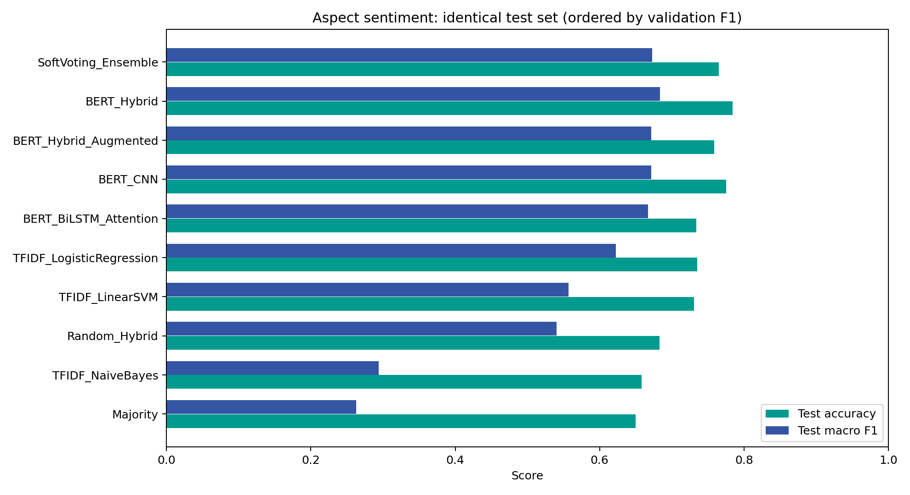
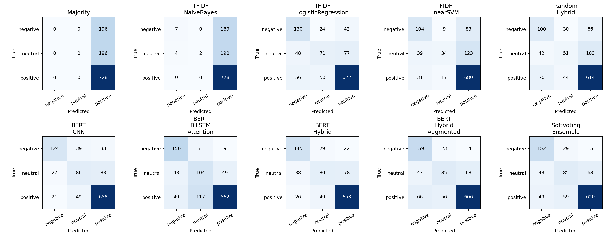
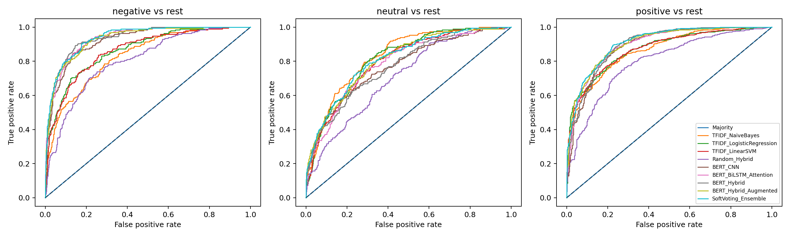
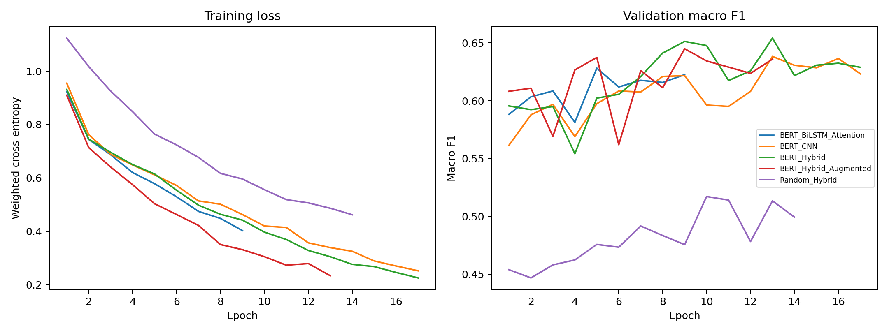

> **Bản holdout để đối chiếu.** Đọc [BAO_CAO_CV.md](BAO_CAO_CV.md) và [Lab02_5Fold_CV.ipynb](Lab02_5Fold_CV.ipynb) để xem kết quả chạy đủ 5 fold.

# Lab02 — Phân tích cảm xúc theo khía cạnh bằng Deep Learning

## 1. Bài toán và dữ liệu

Thực hiện Exercise trang 21 của slide **Chapter 3: Sentiment Analysis project implementation**.
Đầu vào là một cặp **(review, aspect_term)**; đầu ra là `negative`, `neutral` hoặc `positive`.
Ví dụ, “The food was excellent but the service was slow” có thể mang hai nhãn khác nhau khi aspect là `food` và `service`.
Đây là **aspect polarity classification**, giả định đã biết aspect term; không làm aspect extraction và không phân loại toàn câu.

Dùng nguyên hai CSV đã chuẩn hóa của bài trước, sao chép byte-for-byte vào `Lab02/data/`:
`restaurant_aspect_train.csv` (3602 dòng) và
`restaurant_aspect_test.csv` (1120 dòng).
Giữ nguyên nhãn `polarity`, câu `text`, khía cạnh `aspect_term` và vị trí `from/to`.
Các CSV đầu vào đã không chứa `conflict`; pipeline không tự suy ra hoặc gộp nhãn mới.
Mã SHA-256 của dữ liệu được lưu trong `results/data_audit.json` để đối chiếu nguồn.

Phát hiện 1 mẫu train có câu trùng test sau khi chuẩn hóa khoảng trắng/chữ thường;
loại những mẫu đó khỏi phần train, **giữ nguyên toàn bộ test**. Cách chia validation:
fold đầu của `StratifiedGroupKFold(n_splits=5, shuffle=True, random_state=42)`,
group là nội dung câu chuẩn hóa. Chỉ gom nhóm khi chia tập để tránh rò rỉ;
mỗi dòng khía cạnh và nhãn riêng vẫn được giữ lại. Đây là một holdout, không phải kết quả trung bình 5-fold CV.

| Tập | Mẫu khía cạnh | Câu khác nhau | positive | negative | neutral |
| --- | --- | --- | --- | --- | --- |
| train | 2850 | 1567 | 1723 | 626 | 501 |
| validation | 751 | 408 | 440 | 179 | 132 |
| test | 1120 | 600 | 728 | 196 | 196 |

## 2. Tiền xử lý và đặc trưng

- TF-IDF unigram/bigram, `min_df=2`, tối đa 30.000 đặc trưng; fit trên train.
  Đầu vào gồm câu, aspect lặp hai lần và cửa sổ 5 từ hai phía aspect, tương tự cách tạo đặc trưng ở bài trước.
- WordPiece cho các mô hình DL, giữ phủ định và dấu câu. Không loại stopwords hoặc stemming trước BERT.
- BERT dùng cặp `[CLS] aspect [SEP] review [SEP]`, tối đa 96 token;
  chỉ cắt phần review khi quá dài để luôn giữ aspect. Số mẫu bị cắt được ghi trong `bert_features.json`.
- `bert-base-uncased` được **đóng băng**, lấy vector ngữ cảnh từng token (768 chiều) ở tầng cuối;
  lớp chiếu học được đưa về 96 chiều. Đây là feature extraction, không fine-tune toàn bộ BERT.
- `Random_Hybrid` dùng cùng WordPiece và cùng mạng phía sau, embedding 96 chiều khởi tạo ngẫu nhiên.
  So sánh này có thêm khác biệt về lớp chiếu và số tham số, chưa phải ablation kiểm soát hoàn toàn mọi yếu tố.

## 3. Các mô hình

1. Majority (xác suất theo tần suất train), Multinomial Naive Bayes, Logistic Regression và Linear SVM.
   SVM có hiệu chỉnh xác suất bằng 3-fold theo nhóm **bên trong train**; TF-IDF cũng fit riêng trong từng fold.
   Các baseline được huấn luyện lại trên cùng split với DL, không chép điểm từ notebook cũ.
2. CNN: ba nhánh convolution kernel 3/5/7, mỗi nhánh 64 kênh, ReLU và masked max pooling.
3. BiLSTM-Attention: hidden size 64 mỗi hướng; attention học trọng số token, bỏ qua padding.
   Packed sequences giúp LSTM không xử lý phần padding như dữ liệu thật.
4. CNN-BiLSTM-Attention (Hybrid): ghép đặc trưng CNN và BiLSTM-Attention, dropout 0,35, linear 3 lớp.
   Hybrid là một mạng có nhiều nhánh, tự nó không phải ensemble các mô hình độc lập.
5. Soft-voting ensemble: kết hợp xác suất của ba mô hình được huấn luyện độc lập:
   `BERT_CNN, BERT_BiLSTM_Attention, BERT_Hybrid_Augmented`. Trọng số tương ứng: `[0.25, 0.375, 0.375]`.
   Chọn trong 27 bộ trọng số dương đã định trước bằng macro F1 trên validation, không dùng test.

Với nhãn c, ensemble tính `P(c|x) = sum_m w_m * P_m(c|x)` và lấy lớp có xác suất lớn nhất.
Neural training dùng AdamW, learning rate 0.001, batch 64, tối đa 20 epoch,
early stopping patience 4 theo validation macro F1, gradient clipping 1,0 và weighted cross-entropy.
Trọng số lớp tính một lần từ train gốc và dùng chung cả khi tăng cường dữ liệu.
Checkpoint được khôi phục ở epoch có validation macro F1 cao nhất.

## 4. Data augmentation

Chỉ tăng cường phần train sau khi chia tập; validation và test không sinh thêm mẫu.
Dùng synonym replacement bằng từ điển nhỏ cố định và random deletion giới hạn vào các từ
`really`, `very`, `quite`, `just`. Mỗi mẫu sinh tối đa một biến thể cho từng phương pháp nếu đủ điều kiện.
Không thay/xóa từ phủ định hoặc các từ thuộc aspect; bảo toàn vị trí target sau biến đổi.
Loại biến thể trùng lặp và biến thể có câu trùng validation/test.
Số dòng theo phương pháp: `{'original': 2850, 'synonym': 786, 'restricted_deletion': 391}`.
Các mẫu và ID cha nằm trong `data/train_augmented.csv` để kiểm tra thủ công.

Các phép biến đổi là heuristic: bỏ từ tăng cường hoặc thay đồng nghĩa vẫn có thể đổi sắc thái,
do đó **không đảm bảo tăng chất lượng**. Trên lần chạy này augmentation giảm macro F1 test
1.21 điểm phần trăm so với cùng hybrid không augmentation.

## 5. Độ đo và kết quả thực nghiệm

Với mỗi lớp theo one-vs-rest: `Precision = TP/(TP+FP)`, `Recall = TP/(TP+FN)`,
`F1 = 2*Precision*Recall/(Precision+Recall)`; trường hợp mẫu số bằng 0 được gán 0.
Accuracy là tỷ lệ dự đoán đúng. Macro là trung bình đều ba lớp; weighted F1 có trọng số theo số mẫu.
ROC dùng xác suất của từng lớp, không dùng nhãn argmax; AUC báo cáo là macro one-vs-rest.
Macro F1 là tiêu chí chính vì dữ liệu lệch về positive. Các điểm dưới đây đều ở thang 0–1.

| model | validation_f1 | accuracy | precision_macro | recall_macro | f1_macro | f1_weighted | roc_auc_ovr_macro |
| --- | --- | --- | --- | --- | --- | --- | --- |
| SoftVoting_Ensemble | 0.6599 | 0.7652 | 0.6654 | 0.6869 | 0.6727 | 0.7648 | 0.8869 |
| BERT_Hybrid | 0.6542 | 0.7839 | 0.6891 | 0.6816 | 0.6833 | 0.7776 | 0.8686 |
| BERT_Hybrid_Augmented | 0.6450 | 0.7589 | 0.6641 | 0.6924 | 0.6712 | 0.7589 | 0.8821 |
| BERT_CNN | 0.6383 | 0.7750 | 0.6884 | 0.6584 | 0.6716 | 0.7688 | 0.8626 |
| BERT_BiLSTM_Attention | 0.6282 | 0.7339 | 0.6494 | 0.6995 | 0.6669 | 0.7462 | 0.8751 |
| TFIDF_LogisticRegression | 0.5745 | 0.7348 | 0.6282 | 0.6266 | 0.6226 | 0.7291 | 0.8503 |
| TFIDF_LinearSVM | 0.5365 | 0.7304 | 0.6440 | 0.5460 | 0.5568 | 0.6926 | 0.8440 |
| Random_Hybrid | 0.5172 | 0.6830 | 0.5546 | 0.5379 | 0.5402 | 0.6697 | 0.7702 |
| TFIDF_NaiveBayes | 0.2865 | 0.6580 | 0.7647 | 0.3486 | 0.2938 | 0.5311 | 0.8410 |
| Majority | 0.2463 | 0.6500 | 0.2167 | 0.3333 | 0.2626 | 0.5121 | 0.5000 |

Mô hình được **chọn bằng validation** là **SoftVoting_Ensemble**:
test accuracy **0.7652**, macro F1 **0.6727**,
macro ROC-AUC **0.8869**.
Baseline ML tốt nhất theo validation là **TFIDF_LogisticRegression**;
chênh lệch macro F1 test của mô hình được chọn so với baseline đó là
**+5.01 điểm phần trăm**.
Không chọn lại mô hình dựa trên bảng test.

### Ablation

| Thí nghiệm | Mốc so sánh | Biến thể | Delta Accuracy (điểm %) | Delta Macro F1 (điểm %) |
| --- | --- | --- | --- | --- |
| BERT embedding | Random_Hybrid | BERT_Hybrid | 10.09 | 14.31 |
| Data augmentation | BERT_Hybrid | BERT_Hybrid_Augmented | -2.50 | -1.21 |
| Soft voting so với hybrid tăng cường | BERT_Hybrid_Augmented | SoftVoting_Ensemble | 0.62 | 0.15 |

Số dương là tăng, số âm là giảm. Đây là quan sát của một lần chạy với seed 42,
không phải bằng chứng có ý nghĩa thống kê hoặc bảo đảm phương pháp luôn tốt hơn.
Mô hình tốt hơn về accuracy có thể kém hơn về macro F1 nếu ưu tiên lớp positive quá nhiều.

### Kết quả theo lớp của mô hình được chọn

| Nhãn | precision | recall | f1-score | support |
| --- | --- | --- | --- | --- |
| negative | 0.6230 | 0.7755 | 0.6909 | 196.0000 |
| neutral | 0.4913 | 0.4337 | 0.4607 | 196.0000 |
| positive | 0.8819 | 0.8516 | 0.8665 | 728.0000 |

## 6. Phân tích lỗi và hạn chế

Có **263/1120** dự đoán sai ở mô hình được chọn.
Số lỗi theo hướng nhầm: neutral → positive: 68; positive → neutral: 59; positive → negative: 49; neutral → negative: 43; negative → neutral: 29; negative → positive: 15.
Lớp neutral có recall **0.4337**;
khả năng nhận diện lớp này còn hạn chế, nên cần xem macro F1 cùng accuracy.

Các ví dụ dự đoán sai thực tế (năm dòng đầu, không chọn lọc theo câu chuyện kết luận):

- Câu: “Did I mention that the coffee is OUTSTANDING?” — khía cạnh **coffee**; nhãn thật `positive`, dự đoán `neutral`.
- Câu: “Certainly not the best sushi in New York, however, it is always fresh, and the place is very clean, sterile.” — khía cạnh **place**; nhãn thật `positive`, dự đoán `negative`.
- Câu: “I trust the people at Go Sushi, it never disappoints.” — khía cạnh **people**; nhãn thật `positive`, dự đoán `neutral`.
- Câu: “While there's a decent menu, it shouldn't take ten minutes to get your drinks and 45 for a dessert pizza.” — khía cạnh **menu**; nhãn thật `positive`, dự đoán `neutral`.
- Câu: “The sangria's - watered down.” — khía cạnh **sangria**; nhãn thật `negative`, dự đoán `positive`.

Trong bài toán này cần kiểm tra các trường hợp nhiều aspect có cảm xúc đối lập, nhận xét ngầm,
phủ định và ranh giới neutral/positive/negative. Đây là các hướng phân tích; chưa tự gán nguyên nhân
cho từng lỗi nếu chưa đọc thủ công. Toàn bộ lỗi được lưu thành `results/errors_<model>.csv`.

Giới hạn: một seed, một miền restaurant, BERT đóng băng, có thể cắt mất ngữ cảnh xa của câu dài,
augmentation thủ công có thể làm đổi sắc thái. BERT pair chứa tên aspect nhưng chưa đánh dấu
vị trí xuất hiện trong câu; nếu cùng một từ xuất hiện nhiều lần với cảm xúc khác nhau, mô hình
có thể không phân biệt được occurrence. Không so trực tiếp điểm này với bài báo hoặc notebook
có cách chia train/validation và cách xử lý dữ liệu khác.
Hướng tiếp theo: chạy nhiều seed và báo cáo mean/std, fine-tune BERT có đánh dấu target span,
kiểm tra augmentation thủ công, thử back translation và đánh giá trên miền khác.

## 7. Tái lập và tệp nộp

Môi trường đã chạy: `{'python': '3.10.19', 'torch': '2.11.0+cu130', 'numpy': '2.1.3', 'pandas': '2.3.3', 'sklearn': '1.7.1', 'transformers': '5.8.0', 'device': 'cuda', 'gpu': 'NVIDIA GeForce RTX 3060 Laptop GPU'}`. Cấu hình đầy đủ: `results/config.json`;
phiên bản BERT và thống kê token: `results/bert_features.json`;
lịch sử từng epoch: `results/history_*.csv`; log: `results/run.log`.
Đọc `README.md` để chạy lại hoặc dự đoán một cặp câu/khía cạnh mới.
Notebook `Lab02_Aspect_Sentiment.ipynb` trình bày quy trình và hiển thị kết quả đã chạy.
Không cần nộp thư mục cache vector BERT để đọc báo cáo; cache có thể tái tạo.

## 8. Tài liệu tham khảo

- Slide học phần: `../slide/Chapter3_Sentiment Analysis project implementation.pdf`, trang 11–21.
- [SemEval-2014 Task 4: mô tả aspect-based sentiment analysis](https://alt.qcri.org/semeval2014/task4/index.php).
- [BERT-base-uncased model card](https://huggingface.co/google-bert/bert-base-uncased).
- [PyTorch LSTM](https://docs.pytorch.org/docs/stable/generated/torch.nn.modules.rnn.LSTM.html).
- [Scikit-learn: cross-validation và grouped splitting](https://scikit-learn.org/stable/modules/cross_validation.html).
