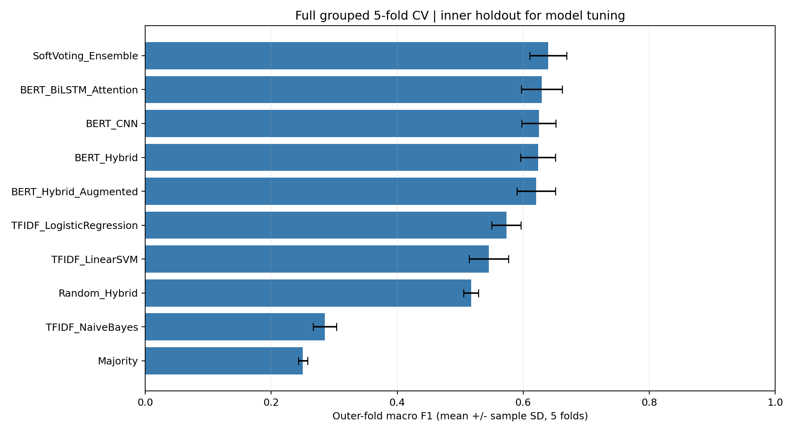
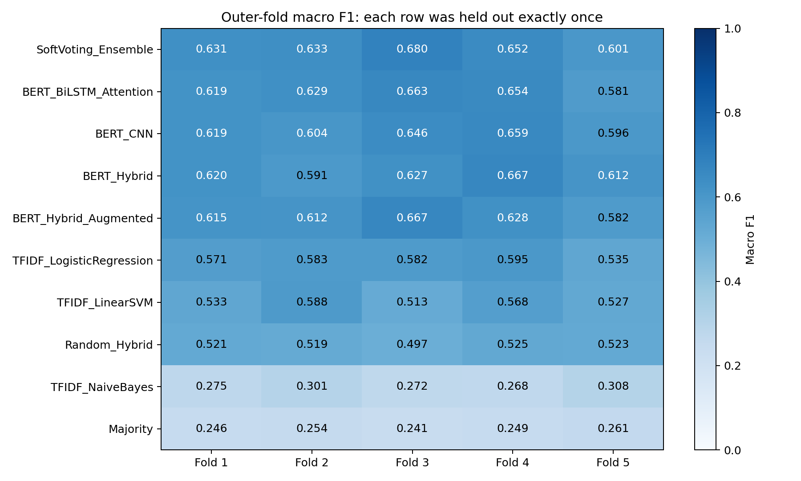
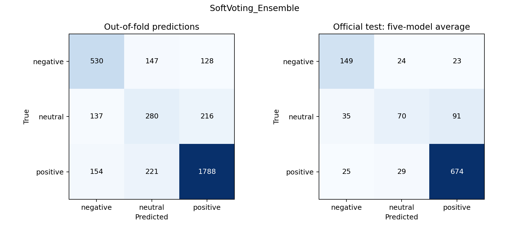
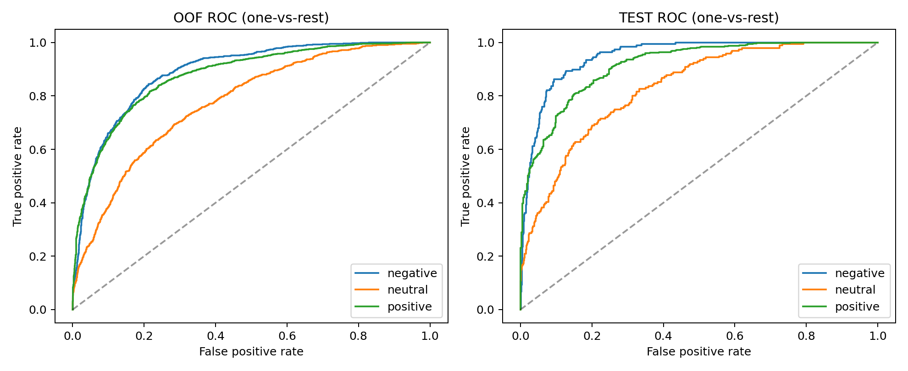

# Lab02 — Kết quả đầy đủ 5-fold cross-validation

## 1. Phạm vi

Đã huấn luyện lại và chấm **10 phương pháp trên đủ 5 outer folds**, tổng cộng **50 lượt đánh giá**.
Gồm 25 mạng DL được fit từ đầu, 20 baseline được fit và 5 soft-voting ensemble.
Đây là kết quả mới, tách biệt bài holdout trước trong `BAO_CAO.md`.
Bài toán giữ nguyên **aspect polarity classification 3 lớp**: negative, neutral, positive.
Đầu vào là `(review, aspect)`; không gộp nhãn thành phân loại cả câu và chưa bổ sung lớp conflict.

## 2. Dữ liệu và thiết kế đánh giá

Dùng nguyên CSV chuẩn hóa: 3.602 train và 1.120 test. Bỏ 1 mẫu train trùng câu với test
khỏi phần development, còn **3601 mẫu**. Không sửa file nguồn và giữ nguyên 1.120 test.
Mã SHA-256 được lưu trong `cross_validation/results/data_audit.json`.

Outer splitter: `StratifiedGroupKFold(5, shuffle=True, random_state=42)`.
Group theo câu chuẩn hóa để các khía cạnh của cùng câu luôn cùng fold.
Trong mỗi outer-train, chia thêm grouped holdout bằng 5-way splitter với seed `42 + fold`;
lấy một phần làm inner-validation, còn lại làm inner-fit.

| fold | inner_fit | inner_validation | outer_evaluation |
| --- | --- | --- | --- |
| 1 | 2291 | 559 | 751 |
| 2 | 2245 | 588 | 768 |
| 3 | 2298 | 561 | 742 |
| 4 | 2360 | 570 | 671 |
| 5 | 2325 | 607 | 669 |

- **Inner-fit:** cập nhật tham số, fit TF-IDF, tạo augmentation, tính class weights.
- **Inner-validation:** chọn epoch tốt nhất và trọng số ensemble.
- **Outer-evaluation:** chỉ chấm điểm sau khi lựa chọn nội bộ hoàn tất.
- **Official test:** đánh giá cuối sau khi đã chọn phương pháp bằng mean CV Macro-F1.

Không refit trên toàn outer-train sau khi chọn epoch. Baseline và DL cùng dùng inner-fit,
tức khoảng 64% development; inner-validation khoảng 16%; outer-evaluation khoảng 20%.
Thiết kế này tránh dùng chính fold đang chấm để chọn epoch/trọng số, nhưng có ít mẫu cập nhật trọng số
hơn cách dùng toàn 4/5 development để train. Vì vậy không so trực tiếp mức điểm với holdout cũ như
thể mọi điều kiện huấn luyện đều giống nhau.
Mỗi mẫu development có **đúng một dự đoán out-of-fold (OOF)** cho mỗi phương pháp.

## 3. Mô hình và huấn luyện

Giữ kiến trúc Lab02: Majority; TF-IDF + NB/LR/SVM; Random Hybrid; BERT-CNN;
BERT-BiLSTM-Attention; BERT-Hybrid; BERT-Hybrid-Augmented; SoftVoting Ensemble.
BERT `bert-base-uncased` đóng băng, cặp `[CLS] aspect [SEP] review [SEP]`, tối đa 96 token.
Vector BERT có thể cache chung vì encoder không học tham số hay thống kê từ tập outer/test.
Mỗi head DL được khởi tạo lại ở mỗi fold. Các mô hình khác nhau giữ cùng seed khởi tạo 42.

AdamW lr=0.001, batch=64, tối đa 20 epoch,
patience=4, dropout 0,35, gradient clipping 1,0, weighted cross-entropy.
Early stopping theo **inner-validation Macro-F1**. SVM dùng 3-fold grouped calibration bên trong inner-fit.
Augmentation chỉ từ inner-fit: thay đồng nghĩa và restricted deletion, bảo vệ aspect/phủ định.
Trong mỗi fold, soft voting của CNN/BiLSTM/Hybrid-Augmented chọn trọng số bằng inner-validation.
Không dùng nhãn outer hoặc test để chọn trọng số đó.

## 4. Kết quả cross-validation: mean ± SD

Tất cả ô dưới đây ở **thang phần trăm**. Mean là trung bình đều năm độ đo outer;
SD là **độ lệch chuẩn mẫu, ddof=1**, không phải khoảng tin cậy.
Macro Precision/Recall/F1 lấy trung bình đều ba lớp; AUC dùng xác suất one-vs-rest.

| Mô hình | Accuracy | Precision macro | Recall macro | F1 macro | F1 weighted | AUC OvR macro |
| --- | --- | --- | --- | --- | --- | --- |
| SoftVoting_Ensemble | 72.10 ± 2.66 | 64.52 ± 3.65 | 64.35 ± 2.08 | 63.94 ± 2.93 | 72.27 ± 1.52 | 85.58 ± 1.83 |
| BERT_BiLSTM_Attention | 71.19 ± 2.45 | 62.85 ± 3.89 | 63.89 ± 2.66 | 62.93 ± 3.24 | 71.55 ± 1.61 | 84.72 ± 1.95 |
| BERT_CNN | 70.47 ± 3.51 | 63.17 ± 3.40 | 63.50 ± 1.73 | 62.48 ± 2.71 | 70.78 ± 2.09 | 84.46 ± 1.94 |
| BERT_Hybrid | 70.40 ± 3.16 | 62.47 ± 3.42 | 63.56 ± 1.85 | 62.34 ± 2.80 | 70.66 ± 2.45 | 84.39 ± 2.08 |
| BERT_Hybrid_Augmented | 70.66 ± 2.68 | 63.37 ± 4.08 | 62.29 ± 2.22 | 62.07 ± 3.07 | 70.76 ± 1.51 | 85.17 ± 1.50 |
| TFIDF_LogisticRegression | 66.68 ± 1.46 | 57.39 ± 2.16 | 57.47 ± 2.31 | 57.33 ± 2.33 | 66.71 ± 1.49 | 80.54 ± 1.46 |
| TFIDF_LinearSVM | 69.17 ± 2.32 | 62.27 ± 2.14 | 52.96 ± 2.63 | 54.54 ± 3.11 | 65.69 ± 3.18 | 80.56 ± 1.87 |
| Random_Hybrid | 61.30 ± 1.51 | 51.97 ± 0.38 | 51.89 ± 1.65 | 51.71 ± 1.15 | 61.37 ± 2.03 | 73.72 ± 2.07 |
| TFIDF_NaiveBayes | 61.01 ± 3.20 | 68.50 ± 16.37 | 34.97 ± 0.71 | 28.49 ± 1.83 | 47.52 ± 4.04 | 77.72 ± 1.86 |
| Majority | 60.13 ± 2.88 | 20.04 ± 0.96 | 33.33 ± 0.00 | 25.02 ± 0.74 | 45.20 ± 3.52 | 50.00 ± 0.00 |

Macro-F1 theo từng fold (thang 0–1):

| model | 1 | 2 | 3 | 4 | 5 |
| --- | --- | --- | --- | --- | --- |
| SoftVoting_Ensemble | 0.6306 | 0.6331 | 0.6803 | 0.6521 | 0.6008 |
| BERT_BiLSTM_Attention | 0.6194 | 0.6290 | 0.6628 | 0.6543 | 0.5807 |
| BERT_CNN | 0.6190 | 0.6040 | 0.6462 | 0.6590 | 0.5959 |
| BERT_Hybrid | 0.6203 | 0.5907 | 0.6272 | 0.6671 | 0.6118 |
| BERT_Hybrid_Augmented | 0.6150 | 0.6116 | 0.6668 | 0.6278 | 0.5821 |
| TFIDF_LogisticRegression | 0.5710 | 0.5832 | 0.5823 | 0.5954 | 0.5347 |
| TFIDF_LinearSVM | 0.5325 | 0.5876 | 0.5127 | 0.5676 | 0.5267 |
| Random_Hybrid | 0.5207 | 0.5195 | 0.4969 | 0.5254 | 0.5230 |
| TFIDF_NaiveBayes | 0.2754 | 0.3011 | 0.2724 | 0.2676 | 0.3081 |
| Majority | 0.2463 | 0.2538 | 0.2413 | 0.2490 | 0.2608 |

Phương pháp được chọn là **SoftVoting_Ensemble**, với CV Macro-F1
**63.94% ± 2.93 điểm phần trăm**.
Lựa chọn được lưu trước khi tính bảng metrics test.
`metrics_oof.csv` tính metrics trên toàn bộ dự đoán OOF đã nối; F1 OOF không nhất thiết bằng mean F1
do F1 phi tuyến và kích thước các fold không hoàn toàn bằng nhau.

## 5. Test chính thức và cách sử dụng mô hình cuối

Với mỗi phương pháp, lấy **trung bình xác suất của 5 estimator ứng với 5 fold**,
rồi dự đoán toàn bộ 1.120 mẫu test. Đây là ensemble qua fold, không phải chia test thành năm phần.
Riêng SoftVoting đã kết hợp ba mạng trong mỗi fold trước khi lấy trung bình qua fold.
Không chọn fold tốt nhất theo test và không chọn lại phương pháp theo bảng test.

| model | accuracy | precision_macro | recall_macro | f1_macro | f1_weighted | roc_auc_ovr_macro |
| --- | --- | --- | --- | --- | --- | --- |
| Majority | 0.6500 | 0.2167 | 0.3333 | 0.2626 | 0.5121 | 0.5000 |
| TFIDF_NaiveBayes | 0.6589 | 0.7950 | 0.3503 | 0.2970 | 0.5328 | 0.8443 |
| TFIDF_LogisticRegression | 0.7366 | 0.6293 | 0.6176 | 0.6186 | 0.7280 | 0.8532 |
| TFIDF_LinearSVM | 0.7384 | 0.6881 | 0.5489 | 0.5618 | 0.6971 | 0.8474 |
| Random_Hybrid | 0.6857 | 0.5614 | 0.5343 | 0.5439 | 0.6721 | 0.7737 |
| BERT_CNN | 0.7777 | 0.6766 | 0.6623 | 0.6613 | 0.7654 | 0.8862 |
| BERT_BiLSTM_Attention | 0.7955 | 0.7050 | 0.6876 | 0.6868 | 0.7827 | 0.8921 |
| BERT_Hybrid | 0.7830 | 0.6826 | 0.6650 | 0.6632 | 0.7682 | 0.8893 |
| BERT_Hybrid_Augmented | 0.7991 | 0.7216 | 0.6770 | 0.6908 | 0.7852 | 0.8953 |
| SoftVoting_Ensemble | 0.7973 | 0.7125 | 0.6811 | 0.6880 | 0.7835 | 0.8982 |

Phương pháp được chọn bằng CV đạt test Accuracy **79.73%**,
Macro-F1 **68.80%**, AUC **0.8982**.
`metrics_same_test_by_fold.csv` lưu điểm của từng fold-model trên cùng test để kiểm tra,
**không phải 5-fold CV trên test**, không dùng các dòng đó như năm tập test độc lập.
Test cố định này đã xuất hiện ở thí nghiệm holdout trước; không phải một tập test mới chưa từng được xem.

## 6. Ablation và giới hạn

Chênh lệch Macro-F1 ghép cặp trên cùng outer fold:

| Thay đổi | Delta F1 mean (điểm %) | SD delta | Fold tăng |
| --- | --- | --- | --- |
| BERT embedding | 10.630 | 2.918 | 5 |
| Augmentation | -0.275 | 3.321 | 2 |
| Ensemble vs Hybrid augmented | 1.872 | 0.436 | 5 |

Các fold có phần train chồng lấp; SD mô tả biến động theo cách chia, không chứng minh ý nghĩa thống kê.
Mới có một seed outer split, không phải repeated CV. Việc chọn phương pháp có mean cao nhất trên CV
cũng có thể gây thiên lệch lựa chọn. Chưa fine-tune BERT, chưa bổ sung conflict, chưa đánh dấu vị trí target.
So sánh Random/BERT còn khác số tham số; augmentation có thể đổi sắc thái và không đảm bảo tăng điểm.
Đọc `errors_<model>.csv` và `classification_report_<model>.json` để xem các lỗi/lớp yếu.

## 7. Tệp và tái lập

- `Lab02_5Fold_CV.ipynb`: notebook mới trình bày và hiển thị kết quả 5-fold.
- `run_cross_validation.py`: toàn bộ quy trình, tự resume fold hoàn thành khi cấu hình/mã nguồn/dữ liệu khớp.
- `cross_validation/fold_01` đến `fold_05`: các tập dữ liệu, 9 checkpoint/baseline, trọng số ensemble và lịch sử.
- `cross_validation/results/metrics_folds.csv`: 50 dòng độ đo outer.
- `cross_validation/results/metrics_cv_summary.csv`: mean/std của mọi độ đo cho 10 phương pháp.
- `cross_validation/results/predictions_oof_*.csv`: đủ 3.601 dự đoán OOF cho mỗi phương pháp.
- `cross_validation/results/metrics_test.csv`: điểm test sau khi trung bình xác suất qua fold.
- `cross_validation/models/selected_model.json`: phương pháp được chọn bằng CV.
- `cross_validation/results/run.log`, `environment.json`, `run_signature.json`: log, phiên bản và mã kiểm tra tái lập.

Chạy `python run_cross_validation.py` trong Lab02; thêm `--allow-download` nếu chưa có BERT cache.
Giữ cache vector bằng `--keep-cache`; mặc định xóa cache vector tạm sau khi dùng, giữ checkpoint.
Chạy `python -m unittest discover -s tests -v` để kiểm tra.
Mã nguồn mô hình và dữ liệu tham chiếu trong `README.md`, `BAO_CAO.md` và notebook holdout trước.
